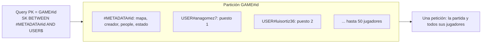

# Single Table Design en Amazon DynamoDB: juego battle royale con Python y boto3

[](https://github.com/KevinAndrey96/python-dynamodb-single-table-design-battle-royale/actions/workflows/ci.yml)


[](LICENSE)

Implementación de referencia del patrón **Single Table Design** en Amazon DynamoDB para el backend de un juego multijugador tipo *battle royale*: usuarios, partidas de hasta 50 jugadores y resultados en **una sola tabla**. Cada patrón de acceso es una sola petición a DynamoDB, sin `Scan` sobre la tabla y sin uniones, y las reglas del juego (cupo, creador, estados) las garantizan **escrituras condicionales y transacciones**, no el código que lee y luego escribe.

Incluye un CLI en español, datos de demostración deterministas, 69 pruebas (100% de cobertura con moto, más pruebas de integración y de concurrencia contra DynamoDB Local), Docker Compose y CI en Python 3.12, 3.13 y 3.14.

## Contenido

- [Modelo de datos](#modelo-de-datos)
- [Patrones de acceso](#patrones-de-acceso)
- [Reglas garantizadas por DynamoDB](#reglas-garantizadas-por-dynamodb)
- [Uso](#uso)
- [Pruebas y calidad](#pruebas-y-calidad)
- [Defectos de la versión de 2021 corregidos](#defectos-de-la-versión-de-2021-corregidos)
- [Estructura](#estructura)
- [Historia y créditos](#historia-y-créditos)

## Modelo de datos

Todas las entidades comparten los atributos genéricos `PK` y `SK`:

| Entidad | `PK` | `SK` | Atributos |
| :-- | :-- | :-- | :-- |
| Usuario | `USER#<usuario>` | `#METADATA#<usuario>` | `username`, `name`, `email` |
| Partida | `GAME#<id>` | `#METADATA#<id>` | `map`, `creator`, `create_time`, `people`, `open_timestamp`, `start_time`, `end_time` |
| Jugador en partida | `GAME#<id>` | `USER#<usuario>` | `game_id`, `username`, `place` |

Dos índices secundarios globales completan los patrones de acceso:

| Índice | Clave de partición | Clave de ordenación | Para qué sirve |
| :-- | :-- | :-- | :-- |
| `OpenGamesIndex` (disperso) | `map` | `open_timestamp` | Solo las partidas que no han empezado tienen `open_timestamp`; al iniciar una partida se borra el atributo y la partida sale del índice sola. |
| `InvertedIndex` | `SK` | `PK` | Invierte la relación partida y jugador: las partidas de un usuario son una consulta. |

La partida y sus jugadores viven en la misma partición. Como `#` (0x23) se ordena antes que `U`, los metadatos quedan primero, y `USER$` (`$` es 0x24) cierra el rango justo después del último `USER#...`:



## Patrones de acceso

| Patrón | Método | Operación de DynamoDB |
| :-- | :-- | :-- |
| Registrar un usuario sin pisar otro | `create_user` | `PutItem` con `attribute_not_exists(PK)` |
| Ver el perfil de un usuario | `get_user` | `GetItem` |
| Crear una partida con su creador dentro | `create_game` | `TransactWriteItems`: `ConditionCheck` del usuario, `Put` de la partida y `Put` del jugador |
| Ver una partida y todos sus jugadores | `get_game` | `Query` sobre la partición con `BETWEEN` |
| Partidas abiertas en un mapa, más recientes primero | `find_open_games(mapa)` | `Query` sobre `OpenGamesIndex` |
| Partidas abiertas en cualquier mapa | `find_open_games()` | `Scan` del índice disperso, que solo contiene partidas sin empezar |
| Unirse a una partida | `join_game` | `TransactWriteItems`: `ConditionCheck`, `Put` condicional y `Update` del contador |
| Iniciar una partida | `start_game` | `UpdateItem` condicional que borra `open_timestamp` |
| Terminar una partida con el ranking | `finish_game` | `TransactWriteItems` con la partida y el puesto de cada jugador (hasta 51 acciones) |
| Historial de partidas de un usuario | `games_for_user` | `Query` sobre `InvertedIndex` con `begins_with(PK, "GAME#")` |
| Carga masiva | `put_all` | `BatchWriteItem` de 25 en 25 con reintento exponencial de los no procesados |

La tabla usa facturación bajo demanda (`PAY_PER_REQUEST`) y todas las consultas paginan.

## Reglas garantizadas por DynamoDB

- **Cupo de 50 jugadores:** unirse es una transacción con tres acciones. Si el usuario no existe, si ya estaba en la partida, si la partida ya empezó o si ya tiene 50 jugadores, DynamoDB rechaza **toda** la transacción y el contador no cambia. Una prueba lanza 69 uniones concurrentes contra DynamoDB Local y entran exactamente 49 (más el creador).
- **Solo el creador inicia, solo con la partida llena y una sola vez:** `creator = :user AND people = :limit AND attribute_not_exists(start_time)`.
- **Una partida termina una vez y solo si empezó**, y cada usuario del ranking debe estar jugándola; si uno no lo está, no se guarda ningún puesto.
- **Errores con nombre:** cuando una condición falla, el repositorio lee los motivos de cancelación de la transacción (o la partida, si hace falta) y lanza `GameFullError`, `AlreadyJoinedError`, `NotGameCreatorError`, `GameNotFullError`, `PlayerNotInGameError`, etc. Los conflictos entre transacciones concurrentes (`TransactionConflict`) se reintentan con espera exponencial y aleatoria; los errores de infraestructura llegan intactos.

## Uso

### Con Docker

```bash
docker compose up --build --abort-on-container-exit
```

Levanta DynamoDB Local y ejecuta `battle-royale demo`, que crea la tabla, carga los datos y recorre todos los patrones:

```text
Tabla battle-royale creada; cargados 961 ítems de demostración.

Partidas abiertas en Desierto de la Tatacoa:
  87d4357b-...  Desierto de la Tatacoa   28/50  abierta   creador julianagonzalez49
  4d4056b4-...  Desierto de la Tatacoa   20/50  abierta   creador luissuarez20

luisortiz36 crea la partida 5556aac5-... en Desierto de la Tatacoa.
Se unen 49 jugadores más; la partida queda llena.
davidortiz42 intenta unirse y la escritura condicional lo rechaza: game 5556aac5-... is full.
felipegomez57 intenta iniciarla: user felipegomez57 did not create game 5556aac5-....
luisortiz36 la inicia a las 2026-11-26T10:29:56.822+00:00 y sale del índice de partidas abiertas.
Termina la partida; gana lauracastro49.
...
Partidas de lauracastro49: 3
  5556aac5-...  puesto 1
  758584f3-...  puesto 20
  87679dfb-...  puesto 5
```

Los mensajes de error del dominio están en inglés y en minúsculas para poder encadenarlos en registros; el resto de la salida está en español.

### En local con uv

Requiere Python 3.12 o superior y [uv](https://docs.astral.sh/uv/).

```bash
uv sync
docker compose up -d dynamodb
export DYNAMODB_ENDPOINT_URL=http://localhost:8000 AWS_ACCESS_KEY_ID=local AWS_SECRET_ACCESS_KEY=local

uv run battle-royale crear-tabla
uv run battle-royale cargar-datos
uv run battle-royale abiertas --mapa "Sierra Nevada"
uv run battle-royale crear-usuario anagomez7 --nombre "Ana Gómez" --email anagomez7@example.com
uv run battle-royale crear-partida anagomez7 "Caño Cristales"
uv run battle-royale unirse <id-partida> <usuario>
uv run battle-royale iniciar <id-partida> anagomez7
uv run battle-royale terminar <id-partida> <ganador> <segundo> <tercero>
uv run battle-royale partida <id-partida>
uv run battle-royale historial anagomez7
```

Sin `DYNAMODB_ENDPOINT_URL` el cliente usa la cuenta de AWS configurada (región de `AWS_REGION`, o `us-east-1`). `--tabla` o `BATTLE_ROYALE_TABLE` cambian el nombre de la tabla. El CLI termina con código 1 ante una regla incumplida y con 2 ante un uso incorrecto.

### Datos de demostración

`cargar-datos` genera siempre los mismos datos para la misma semilla (`--semilla`, por defecto 2021): 300 usuarios con nombres colombianos y correos `@example.com`, y 16 partidas en cuatro mapas (Desierto de la Tatacoa, Caño Cristales, Sierra Nevada y Cañón del Chicamocha) que cubren todos los estados: 6 abiertas, 2 llenas esperando al creador, 4 en curso y 4 terminadas con el puesto de cada jugador.

## Pruebas y calidad

- **67 pruebas unitarias con [moto](https://github.com/getmoto/moto)** y 100% de cobertura de líneas y ramas: cada patrón de acceso, cada regla y cada error con nombre, los reintentos de lotes y de conflictos, la idempotencia del esquema, el generador de datos y todos los comandos del CLI.
- **2 pruebas de integración contra DynamoDB Local** (`pytest -m integration`): la demo completa y 69 uniones concurrentes desde 16 hilos sobre la misma partida.
- `ruff` (lint y formato) y `mypy --strict` con los tipos de `types-boto3`.
- CI en GitHub Actions: calidad, pruebas en Python 3.12, 3.13 y 3.14, integración con DynamoDB Local como servicio, prueba de humo con Docker Compose y construcción del paquete. Dependabot vigila uv, las acciones y las imágenes de Docker.

## Defectos de la versión de 2021 corregidos

| Versión de 2021 | Ahora |
| :-- | :-- |
| `people <= 50` en la condición de unirse dejaba entrar al jugador 51 | `people < 50`, comprobado con una prueba de concurrencia |
| `except Exception` que imprimía "Could not add user" para cualquier fallo, incluso credenciales o red | Errores con nombre a partir de los motivos de cancelación; los de infraestructura se propagan |
| Identificadores de partida y usuario fijos en el código; el README documentaba argumentos que los scripts no aceptaban | CLI con subcomandos y parámetros reales |
| Sin índices secundarios: no existían los patrones de partidas abiertas ni de historial | `OpenGamesIndex` disperso e `InvertedIndex` |
| Unirse no comprobaba que el usuario existiera | `ConditionCheck` del usuario dentro de la transacción |
| Entidades que fallaban con `AttributeError` si faltaba un atributo | Modelos tipados con atributos opcionales explícitos |
| README con la clave de ordenación equivocada, `PutItem` donde había una transacción e insignia MIT sin archivo de licencia | Documentación verificada contra el código y licencia incluida |
| Capacidad aprovisionada de 1 RCU y 1 WCU, metadatos de Cloud9 y `.pyc` versionados | Facturación bajo demanda e historial depurado |

## Estructura

```text
src/battle_royale/
  keys.py        diseño de claves, índices y límites
  models.py      User, Game, Player y su conversión a ítems
  repository.py  patrones de acceso, transacciones y diagnóstico de condiciones
  errors.py      errores del dominio
  schema.py      creación y borrado idempotentes de la tabla y sus índices
  seed.py        generador determinista de datos de demostración
  cli.py         CLI en español
tests/           pruebas con moto e integración con DynamoDB Local
```

## Historia y créditos

El modelo de datos sigue el tutorial oficial de AWS [*Modeling Game Player Data with Amazon DynamoDB*](https://aws.amazon.com/tutorials/data-modeling-gaming-app-with-dynamodb/), que hice en un entorno de AWS Cloud9 en enero de 2021. Ese primer commit (los scripts del tutorial con sus datos de ejemplo) se conserva en la etiqueta `v0.1-aws-tutorial-2021`. En 2026 el proyecto se reescribió por completo: código, pruebas y datos de demostración propios, con los patrones del tutorial que faltaban, las reglas corregidas y errores con nombre. El historial se depuró para quitar los metadatos de Cloud9 y los `.pyc`.

## Licencia

[MIT](LICENSE) © 2021-2026 Kevin Andrey Herrera Silva
