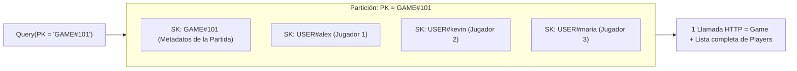

# Amazon DynamoDB Single-Table Design (Battle Royale Pattern)

[](https://www.python.org/)
[](https://aws.amazon.com/dynamodb/)
[](https://boto3.amazonaws.com/)
[](LICENSE)

Guía práctica y código de referencia para el modelado de datos relacionales en **Amazon DynamoDB** mediante el patrón **Single-Table Design** (*Diseño de Tabla Única*), basado en el popular caso de estudio de videojuegos multijugador (*Battle Royale*).

Este patrón demuestra cómo modelar relaciones **1 a N** y **N a M** en una sola tabla NoSQL, reduciendo la latencia de consulta a un único *roundtrip* de red sin necesidad de costosas operaciones de escaneo (*Scan*) ni uniones en memoria (*Joins*).

---

## 🏛️ Esquema de Tabla Única & Patrones de Clave

La tabla `battle-royale` utiliza claves genéricas sobrecargadas: **Partition Key (`PK`)** y **Sort Key (`SK`)**.

| Tipo de Entidad | Clave de Partición (`PK`) | Clave de Ordenación (`SK`) | Atributos Principales |
|---|---|---|---|
| **Usuario (*User*)** | `USER#<username>` | `USER#<username>` | `name`, `email`, `birthdate`, `address` |
| **Partida (*Game*)** | `GAME#<game_id>` | `GAME#<game_id>` | `creator`, `map`, `create_time`, `start_time` |
| **Mapeo Jugador-Partida (*Player*)** | `GAME#<game_id>` | `USER#<username>` | `place`, `time` |

### La magia del Single-Table Design:
Al compartir la misma `PK` (`GAME#<game_id>`) entre la entidad `Game` y todos sus `UserGameMapping` (jugadores inscritos), se puede recuperar la partida **y todos sus participantes** en una **única operación `Query`**:



---

## 📋 Matriz de Patrones de Acceso

| Patrón de Acceso | Script Python | Operación DynamoDB | Descripción |
|---|---|---|---|
| **Crear Tabla** | `scripts/create_table.py` | `CreateTable` | Define claves PK y SK con throughput aprovisionado |
| **Cargar Datos Masivos** | `scripts/bulk_load_table.py` | `BatchWriteItem` | Carga inicial de usuarios, partidas y asignaciones |
| **Obtener Partida y Jugadores** | `application/fetch_game_and_players.py` | `Query` | Trae metadatos del juego y jugadores en un solo query |
| **Unir Jugador a Partida** | `application/join_game.py` | `PutItem` con `ConditionExpression` | Registra jugador evitando duplicados concurrentes |
| **Iniciar Partida** | `application/start_game.py` | `UpdateItem` con `ConditionExpression` | Transiciona estado a iniciado de forma atómica |

---

## 🚀 Guía de Ejecución Local

### 1. Requisitos Previos
* Python 3.8+
* Credenciales de AWS configuradas localmente (`~/.aws/credentials`) o [DynamoDB Local](https://docs.aws.amazon.com/amazondynamodb/latest/developerguide/DynamoDBLocal.html).
* Instalar `boto3`:
  ```bash
  pip install boto3
  ```

### 2. Crear la Tabla y Cargar Datos
```bash
# 1. Crear tabla 'battle-royale'
python scripts/create_table.py

# 2. Poblar datos de prueba (usuarios y partidas)
python scripts/bulk_load_table.py
```

### 3. Ejecutar Casos de Uso
```bash
# Consultar una partida y todos sus jugadores en 1 query:
python application/fetch_game_and_players.py 3d42fda7-2d99-4dc7-8a16-9e9009eb8b6a

# Unir un usuario a una partida:
python application/join_game.py 3d42fda7-2d99-4dc7-8a16-9e9009eb8b6a 'cda5aa58'
```

---

## 💡 Lecciones Clave de Arquitectura NoSQL

1. **Modelar primero los accesos, luego la tabla:** En DynamoDB, a diferencia de SQL, no se diseña en torno a las entidades y formas normales, sino en torno a las preguntas exactas que la aplicación necesita responder en producción.
2. **Evitar Scan a toda costa:** El escaneo degrada el rendimiento de forma cuadrática y aumenta drásticamente los costos de lectura (RCUs). Con `PK` y `SK` bien diseñados, el 100% de los flujos de lectura utilizan `Query` o `GetItem`.
3. **Escrituras condicionales para consistencia:** El uso de `attribute_not_exists(PK)` garantiza integridad referencial y previene *race conditions* sin bloqueos pesados de base de datos.

---

## 📄 Licencia
Este proyecto es código abierto bajo la licencia [MIT](LICENSE).

**Autor:** [Kevin Andrey Herrera Silva](https://github.com/KevinAndrey96) · Bogotá, Colombia
